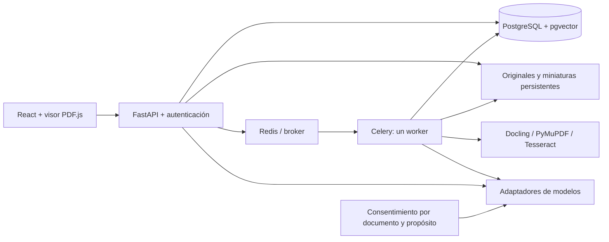

# Arquitectura

RenPdf conserva la base `372dbcb` del [template oficial](https://github.com/fastapi/full-stack-fastapi-template)
y la adaptación local `1c32e668065d7e5490263d90e75eb4b7cdb9fcba`. Monolito modular
FastAPI/SQLModel, React/TypeScript/Vite/TanStack Router y Query, Tailwind/shadcn.
Celery separa el trabajo documental de HTTP; PostgreSQL es la fuente de verdad.

Servicios obligatorios: PostgreSQL+vector, Redis, API, worker y almacenamiento.
El scheduler recupera trabajos aceptados que aún no llegaron al broker y trabajos
interrumpidos; no almacena su resultado como fuente de verdad. Los originales
se montan en `./storage`; el worker y la API comparten la misma raíz.

Proveedores reales: Gemini (`google-genai`), Ollama nativo, llama.cpp y OpenAI
compatible (HTTPX). Descubrimiento no envía documentos ni carga modelos.
Una capacidad declarada no se presenta como comprobada mediante inferencia.
Cloud se autoriza por documento/proveedor/alcance, sin fallback implícito.

Docling NativePdfPipeline es la ruta base instalada, sin pesos neuronales.
PyMuPDF complementa tablas y renderiza regiones; Tesseract realiza OCR local.
El pipeline avanzado requiere artefactos configurados explícitamente. No hay
importación de Torch en la ruta ligera ni descargas automáticas de modelos.

Frontend: biblioteca, workspaces, visor de una página a la vez, chat SSE,
fuentes, consentimiento, notas, marcadores, selección de modelos y diagnósticos.
El módulo de investigación se carga al abrir un workspace. El cliente se genera
desde OpenAPI, con DTOs públicos separados de secretos y claves de almacenamiento.

La navegación agrupa investigación, trazabilidad, Studio, Laboratorio y Estudio.
Cada grupo tiene rutas y carga de código independientes. El chat ocupa el área
principal, con fuentes múltiples y notas a su lado; el lector se abre a demanda.
Studio transforma copias locales con linaje; learning conserva informes citados,
fichas y repasos. Trazabilidad consulta la misma persistencia y metadatos medidos
por ejecución, sin enviar telemetría a un servicio externo.
